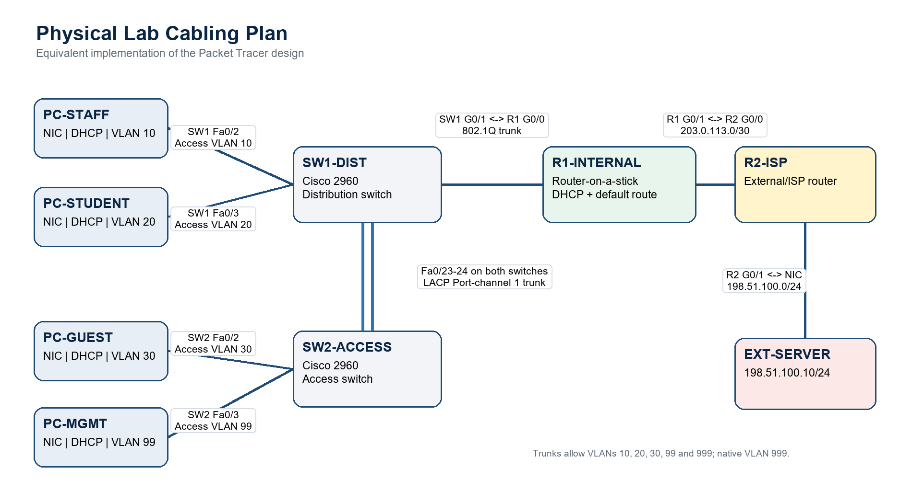

# Enterprise Network Lab

A Cisco Packet Tracer project exploring how a small organization can move from a flat network to separate staff, student, guest, and management VLANs—with centralized DHCP, inter-VLAN routing, and redundant switch links.

**[View the live interactive webpage](https://sme-network-design-implementation.vercel.app)**

**[Open the lab](lab/enterprise-network.pkt)** · **[Take the guided tour](docs/demo-walkthrough.md)** · **[Read the case study](docs/case-study.md)** · **[Inspect the evidence](evidence/README.md)**

*Diagram recovered from the original report. “Physical Lab Cabling Plan” describes the wiring arrangement; it is not evidence of a hardware deployment.*

## What this project demonstrates

| Capability | Implementation | What to inspect |
|---|---|---|
| Layer 2 segmentation | Four routed VLANs plus unused/native VLAN 999 | [VLAN and addressing plan](docs/design.md) |
| Inter-VLAN communication | 802.1Q trunk and R1 router subinterfaces | [R1 configuration](configs/R1-INTERNAL.ios) |
| Automatic addressing | Four DHCP pools with reserved infrastructure ranges | [Endpoint walkthrough](tests/PC-tests.md) |
| External routing | R1 default route and R2 return routes | [Routing explanation](docs/design.md#routing-and-packet-path) |
| Switch-link redundancy | Two-link LACP EtherChannel; PVST with SW1 root primary | [Original SW2 evidence](evidence/README.md#original-switch-evidence) |
| Access-layer controls | Port security, PortFast/BPDU Guard, disabled unused ports, SSH configuration | [Security scope](docs/design.md#security-and-limitations) |

## Explore in your browser

For a browser introduction, use the **[interactive network webpage](website/README.md)**. It includes a clickable topology, forward and reply packet paths, an EtherChannel member-failure illustration, addressing, historical evidence, and project downloads. Open `website/dist/index.html` after building with `python website/build.py`, or extract the standalone webpage ZIP and open its `index.html`. No Packet Tracer installation is needed to explore the webpage. The model explains the documented design; it does not execute network tests.

## Try it in Packet Tracer

1. Download the repository using GitHub's **Code → Download ZIP**, then extract it. Alternatively, download the `.pkt` through its **Raw / Download raw file** control.
2. Open `lab/enterprise-network.pkt` in Cisco Packet Tracer. The file was successfully opened in **9.0.0.0810** during packaging; this is an opening check, not a complete functional retest.
3. Start with the [guided tour](docs/demo-walkthrough.md). It explains the packet path and offers a few representative commands rather than requiring every device to be checked.
4. To build the topology yourself, follow the [build guide](docs/build-guide.md).

The lab and four configuration scripts are preserved from the original assignment without network changes. **Evidence is historical:** the reports record successful PC connectivity tests and contain SW2 screenshots. Device-by-device retesting and saved-lab/configuration reconciliation were not completed during this refinement. The [evidence register](evidence/README.md) separates captured results, reported results, and checks with no retained output.

## Explore the repository

| Location | Purpose |
|---|---|
| [lab](lab/enterprise-network.pkt) | Original Packet Tracer network, renamed for distribution |
| [configs](configs/) | Four original IOS configuration scripts |
| [docs/design.md](docs/design.md) | Device roles, addressing, ports, routing, and tradeoffs |
| [docs/build-guide.md](docs/build-guide.md) | Rebuild instructions and documented lab credentials |
| [docs/case-study.md](docs/case-study.md) | Engineering decisions, reported troubleshooting, and lessons |
| [docs/demo-walkthrough.md](docs/demo-walkthrough.md) | Text tour and a 2–3-minute recording storyboard |
| [assets](assets/) | Report diagram and editable Mermaid topology source |
| [evidence](evidence/README.md) | Original screenshots, provenance, and evidence status |
| [tests](tests/README.md) | Optional manual commands and result interpretation |
| [website](website/README.md) | Interactive explainer, build instructions, and GitHub Pages publishing |

## Boundaries of the lab

- VLANs separate broadcast domains; the original configuration allows inter-VLAN routing, including guest-to-management communication. No inter-VLAN ACL policy is implemented.
- R2 and `198.51.100.10` simulate an external network. This is not real Internet connectivity. The configured DHCP DNS value `8.8.8.8` is not backed by a demonstrated DNS path.
- EtherChannel provides member-link redundancy, not redundant routers or switches. R1 and SW1 remain single points of failure.
- Credentials and 1024-bit RSA settings are classroom examples. See the [build guide](docs/build-guide.md#lab-credentials-and-access) before attempting device access; this is not a production-hardening template.

## Project origin and portfolio refinement

The topology, configurations, and original results were produced for the **NET2201 Computer Networks group assignment**. Credit for that baseline belongs to the original project group.

This personal portfolio edition reorganizes the repository, consolidates the reports, extracts existing evidence, and adds a guided demonstration and case study. It does not claim individual ownership of the original group implementation or new live-test results. Original reports and assignment planning materials are preserved in a separate local backup; student IDs and private collaboration links are excluded from this public package.
