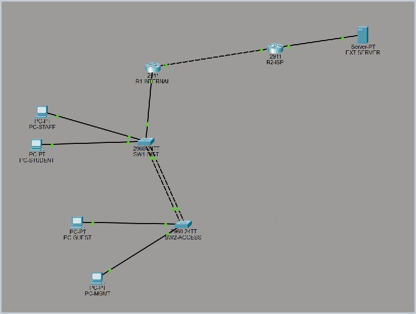

# Case study: a small enterprise network in Packet Tracer

[Back to project](../README.md) · [Full design](design.md) · [Evidence](../evidence/README.md)

## Problem and approach

The original NET2201 group assignment models an organization moving away from a flat network. Staff, students, guests, and administrators need separate broadcast domains, automatic addressing, and a routed path to a simulated external network. The design also needs to demonstrate switch-link redundancy and common access-layer controls using a small, understandable topology.

The group implemented two Cisco 2911 routers, two 2960 switches, four internal PCs, and one external server. Four `/24` VLAN subnets give each role a predictable address space. R1 supplies the VLAN gateways and DHCP pools, while R2 represents the ISP side of the lab.

*Historical topology screenshot. Device layout and link indicators illustrate the original project; they are not a current test result.*

## Engineering decisions

| Decision | Why it suits this lab | Tradeoff |
|---|---|---|
| Router-on-a-stick | Makes VLAN tags, gateways, and inter-VLAN packet paths visible with one internal router | All routed VLAN traffic depends on one router and trunk |
| Separate DHCP pools on R1 | Keeps address assignment aligned with each directly connected subnet | DHCP and routing share the same failure point |
| Static/default routing | Makes the outward and return paths easy to inspect in a two-router topology | More manual maintenance as networks grow |
| Two-link LACP EtherChannel | Demonstrates bundling and potential member-link redundancy without adding switches | Does not survive failure of either switch |
| Explicit STP root selection | Makes SW1 the intended root for operational VLANs | A bundled-link topology alone does not demonstrate an independent alternate STP path |
| Management VLAN and edge controls | Separates management addressing and illustrates port-level protections | VLAN membership alone does not restrict routed access |

The strongest explanatory example is the return path. R1 can send unknown destinations toward R2, but R2 still needs routes back to all four internal subnets. A correct forward path without a return path cannot deliver a successful round-trip ping.

## What the retained evidence supports

The original reports and checklists record successful DHCP assignment, gateway pings, selected inter-VLAN pings, external pings, and traceroutes. Raw endpoint output was not retained in the supplied folder, so these remain **reported results**.

The PDF also contains four SW2 screenshots. They provide historical evidence of VLAN membership, a native-VLAN-999 trunk, a two-member LACP channel, and STP output. The small STP image cannot support a detailed independent root/state assessment. The [evidence register](../evidence/README.md) links every recovered image and states its limits.

The Word report marks device output as pending, whereas the PDF contains some of that output. The PDF's test table also pairs several commands with incorrect expected results. This edition replaces those conflicting status statements with one register and correctly matched expectations. It does not treat prepared test commands as completed tests.

## Troubleshooting recorded in the original report

| Reported issue | Reported correction | Lesson |
|---|---|---|
| Invalid global BPDU Guard command form | Corrected the command, then moved edge protections to access interfaces | Check both command syntax and scope |
| RSA key-generation syntax incompatibility | Used `crypto key generate rsa general-keys modulus 1024` | IOS support depends on the target platform |
| Edge-port settings could affect switch-to-switch links | Removed global defaults, scoped access-port settings, and explicitly disabled them on channel members | Endpoint assumptions should not be applied to infrastructure links |

These incidents are described in the original report. The local folder has no Git history or original error transcripts to corroborate their sequence; they are attributed to the report rather than presented as newly reproduced faults. The current scripts contain the final forms described above.

## Portfolio contribution

The original topology, configurations, and implementation results belong to the assignment group. This personal extension focuses on communicating that work:

- Organized a downloadable lab, readable design, rebuild instructions, and a short demonstration route.
- Recovered report illustrations and switch evidence as directly accessible files.
- Distinguished source configuration, historical screenshots, reported results, and unperformed checks.
- Explained the routing and redundancy choices alongside their practical limitations.
- Removed assignment submission logistics, duplicate report files, student IDs, and private document links from the public package while preserving originals separately.

No network redesign or new successful end-to-end test is claimed. The `.pkt` and four IOS configurations are preserved byte-for-byte from the supplied files.

## Limits and next demonstration

This is an educational simulation, not a deployment claim. Guests can reach the management VLAN under the baseline design; the simulated ISP is not Internet access; advertised DNS does not prove DNS resolution; and classroom passwords and RSA settings are not production guidance.

A useful next recording is a short tour of the topology followed by a representative ping and the existing LACP output. A member-link shutdown can be added in a disposable copy if desired. The [demonstration guide](demo-walkthrough.md) provides the sequence and restoration steps without presenting unrecorded behavior as a result.
