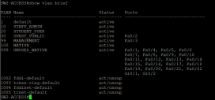
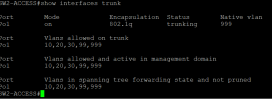
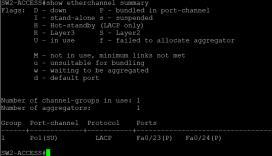
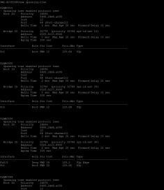

# Evidence register

[Back to project](../README.md) · [Case study](../docs/case-study.md) · [Optional test commands](../tests/README.md)

This register reconciles the original reports and checklists. **No new end-to-end test suite was completed during the portfolio refinement.** Existing screenshots are historical, and a written success statement is kept separate from retained raw output.

## Status definitions

- **Historical capture:** an original report image is available; it describes that capture, not a fresh run.
- **Reported success:** the original report/checklist says the test succeeded, but supporting raw output is absent.
- **Configuration only:** a command or setting is present in the scripts; its runtime behavior is not established by retained evidence.
- **Not recorded:** no result is available; a procedure may exist for a future demonstration.

## Results and expectations

| ID | Check | Expected result | Retained observation / status | Evidence or procedure |
|---|---|---|---|---|
| E01 | Topology | Two routers, two switches, four internal PCs, external server | Historical topology image | [Original topology](screenshots/original-topology.png) |
| E02 | SW2 VLAN membership | VLANs 10/20/30/99/999; F0/2 in 30, F0/3 in 99 | Historical capture shows these assignments | [VLAN output](screenshots/report-sw2-vlans.png) |
| E03 | SW2 trunk | Po1 trunk, native 999, allowed 10/20/30/99/999 | Historical capture shows these fields | [Trunk output](screenshots/report-sw2-trunk.png) |
| E04 | SW2 EtherChannel | LACP Po1 in use with two bundled members | Historical capture: `Po1(SU)`, `Fa0/23(P)`, `Fa0/24(P)` | [Channel output](screenshots/report-sw2-etherchannel.png) |
| E05 | STP | SW1 root for VLANs 10/20/30/99 | Historical SW2 output retained; resolution limits detailed interpretation | [STP output](screenshots/report-sw2-stp.png) |
| E06 | DHCP | Each client in its VLAN's pool with correct gateway | Reported success; no endpoint/binding transcript retained | [PC procedure](../tests/PC-tests.md) |
| E07 | Gateway pings | Each PC reaches its own gateway | Reported success; no raw output retained | [PC procedure](../tests/PC-tests.md) |
| E08 | Selected inter-VLAN pings | Staff ↔ student; guest ↔ management reachable | Reported success; no raw output retained | [PC procedure](../tests/PC-tests.md) |
| E09 | External ping/traceroute | Reach 198.51.100.10 through R1 and R2 | Reported success; no raw output retained | [Demo procedure](../docs/demo-walkthrough.md) |
| E10 | R1/R2 routes and interfaces | Correct connected, static, default routes; used interfaces up | Configuration only | [R1 commands](../tests/R1-INTERNAL-tests.ios), [R2 commands](../tests/R2-ISP-tests.ios) |
| E11 | SSH and edge protections | SSH access and intended port-level controls | Configuration only; no successful login or triggered-security evidence retained | [Security scope](../docs/design.md#security-and-limitations) |
| E12 | One member fails and returns | Cross-switch reachability with one member; both bundled after restoration | Not recorded | [Failure procedure](../docs/demo-walkthrough.md#optional-link-failure-demonstration) |
| E13 | Save/reopen persistence | Working state survives saving and reopening | Not recorded as a functional test | [Build guide](../docs/build-guide.md) |

## Original switch evidence

Images below were extracted without changing their content from page 15 of the supplied PDF. Their capture dates and Packet Tracer version are unknown. Small images are preserved at native resolution; extraction cannot recover detail missing in the source.

### E02 — VLAN membership

The access-port rows identify the guest and management VLAN assignments. VLAN 1 and default reserved VLAN entries may still appear; that does not mean user ports use them.

### E03 — Trunk state

Po1 is the logical trunk. Native VLAN 999 and the allowed VLAN list align with the documented design.

### E04 — LACP bundle

`S` denotes a Layer 2 channel, `U` denotes in use, and `(P)` denotes a bundled member. This is evidence of the recorded bundled state, not of a tested failure transition.

### E05 — STP output

Retained for provenance. The image is too small for a dependable full reading of every root ID and port state. SW1 root-primary configuration is independently visible in the script; a current root-election result would need a readable capture.

## Source provenance

| Published asset or statement | Original source | Handling |
|---|---|---|
| Original topology screenshot | Word report, Figure 1 / embedded image 1; also shown in PDF | Extracted to screenshots; no recapture claimed |
| Cabling plan in assets | Word report, Figure 2 / embedded image 2 | Extracted unchanged; not a hardware photo |
| Four SW2 screenshots | PDF report, page 15 | Extracted unchanged with their original resolution |
| Successful PC-test statements | Original tests README, workplan, and report verification sections | Preserved as reported results only |
| Troubleshooting narrative | Report troubleshooting sections | Attributed to the report; historical transcripts unavailable |

The supplied sources were `NET2201-Computer Network Assignment.pdf` (a 26-page working report, despite its filename) and `NET2201-Enterprise-Network-Report-Credentials-Updated.docx`. The PDF's verification table has misaligned expected-result entries; this register uses the actual purpose of each command. Original documents are preserved in a separate local backup and excluded from public distribution because they contain personal details, private collaboration information, and unfinished submission material.

## Packaging observations on 16 October 2026

The `.pkt` opened in the installed Cisco Packet Tracer **9.0.0.0810**. A limited R1 console attempt did not authenticate using the documented console password; the cause was not determined. No configuration was changed or saved. Manual device-by-device verification was discontinued, so opening success must not be read as full functional compatibility or configuration parity.

The [integrity manifest](integrity.json) records hashes for the preserved lab and configuration scripts, their original source names, and equality to the separate backup. It demonstrates file preservation only, not network operation.

## Adding evidence later

For a voluntary new demonstration, save screenshots with readable command/output text and transcripts in [cli](cli/README.md). Record the test ID, actual capture date, Packet Tracer version, device, starting lab state, expected result, actual result, and relative evidence links. Keep failures and recovery steps. Mark a result successful only after inspecting the corresponding output; unsupported commands and unperformed tests remain separate statuses.
